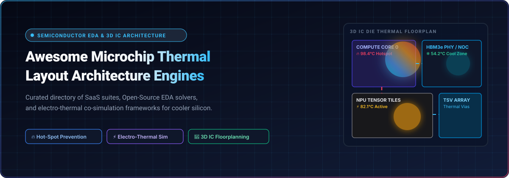
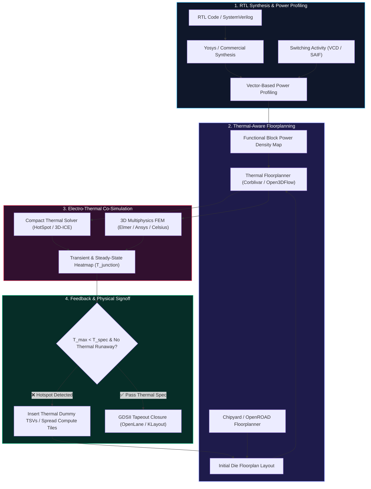

<div align="center">



# ⚡ Awesome Microchip Thermal Layout Architecture Engines 🌡️

**Curated Directory of Enterprise SaaS Platforms, Open-Source EDA Engines & Electro-Thermal Co-Simulation Frameworks**

*Mastering Thermal-Aware Floorplanning, 3D IC Heat Dissipation, Hotspot Prevention & Physical Silicon Reliability*

<br/>

<p align="center">
  <a href="https://github.com/ishandutta2007/Awesome-Awesome-Awesome"></a><a href="https://discord.gg/jc4xtF58Ve"></a>
  <a href="https://github.com/ishandutta2007/Awesome-Microchip-Thermal-Layout-Architecture-Engines/stargazers"></a>
  <a href="https://github.com/ishandutta2007/Awesome-Microchip-Thermal-Layout-Architecture-Engines/network/members"></a>
  <a href="https://github.com/ishandutta2007/Awesome-Microchip-Thermal-Layout-Architecture-Engines/blob/main/LICENSE"></a>
  <a href="https://github.com/ishandutta2007/Awesome-Microchip-Thermal-Layout-Architecture-Engines/pulls"></a>
  <a href="https://github.com/ishandutta2007"></a>
</p>

</div>

---

## 📑 Table of Contents

- [📌 Executive Overview & Core Problem](#-executive-overview--core-problem)
- [📊 Sector Overview & Market Dynamics](#-sector-overview--market-dynamics)
- [🏢 Enterprise SaaS & Hosted EDA Platforms](#-enterprise-saas--hosted-eda-platforms)
- [🧩 Open-Source GitHub Projects & Solvers](#-open-source-github-projects--solvers)
- [🔬 Architecture Workflow & Electro-Thermal Co-Simulation Flow](#-architecture-workflow--electro-thermal-co-simulation-flow)
- [🏷️ Taxonomy & Engine Classification](#-taxonomy--engine-classification)
- [❓ Frequently Asked Questions (FAQ)](#-frequently-asked-questions-faq)
- [📖 Glossary of Technical Terms](#-glossary-of-technical-terms)
- [🤝 How to Contribute](#-how-to-contribute)
- [📈 Star History](#-star-history)
- [💖 Support & Community](#-support--community)
- [⚖️ Disclaimer](#️-disclaimer)

---

## 📌 Executive Overview & Core Problem

Modern microprocessors, high-performance computing (HPC) accelerators, and AI GPUs now routinely push thermal design powers (TDP) past **700W to 1,000W per package**. With the mainstream adoption of **heterogeneous chiplet architectures**, **through-silicon vias (TSVs)**, and **3D IC vertical die stacking**, heat dissipation is no longer a downstream packaging afterthought — it is a primary constraint during early architectural floorplanning and physical layout.

Unmitigated thermal hotspots induce:
- **Catastrophic Thermal Runaway**: Exponential leakage current increases under high localized junctions ($I_{leakage} \propto T^2$).
- **Electromigration (EM) Acceleration**: Accelerated metal interconnect voiding and short circuits governed by Black’s equation ($MTTF \propto e^{\frac{E_a}{k_B T}}$).
- **Severe Clock Skew & Timing Closure Degradation**: Thermal gradients alter gate delays non-uniformly across clock tree distributions.
- **Aggressive Dynamic Thermal Throttling (DVFS)**: Severe loss of sustained computational performance and memory bandwidth.

This repository curates premier **commercial EDA SaaS platforms** and **open-source physical layout solvers** delivering physics-based thermal modeling, reduced-order learning algorithms, and electro-thermal co-simulation engines.

---

## 📊 Sector Overview & Market Dynamics

The global **Electronic Design Automation (EDA)** software market is valued at approximately **$15.8 Billion in 2024** and is projected to expand to **$24.5 Billion by 2030**, growing at a robust compound annual growth rate (CAGR) of **9.2%**. Within this ecosystem, the specialized segment dedicated to **Semiconductor Thermal Management, Chiplet Electro-Thermal Co-Simulation, and IC Packaging Thermal Analysis** accounts for an estimated **$3.8 Billion to $4.2 Billion**.

The sector structure is **highly concentrated (oligopolistic / winner-take-most)**. A triad of legacy EDA conglomerates — **Synopsys**, **Cadence Design Systems**, and **Siemens EDA**, reinforced by **Ansys** (under a $35B acquisition by Synopsys) — controls upwards of **78% to 82%** of global enterprise design-signoff market share. However, the market is undergoing strategic diversification:
1. **Specialized High-Growth Startups**: Companies such as *ProteanTecs* (on-die telemetry health agents), *Celestial AI* (photonic interposers mitigating electrical interconnect heat), and *Movellus* (dynamic thermal-compensating clock trees) capture lucrative architectural niches.
2. **Open-Source EDA Revolution**: Academic institutions and community consortia (e.g., *OpenROAD Project*, *Open3DFlow*, *TASChips*, *HotSpot*, *Elmer FEM*) are building transparent, reproducible RTL-to-GDSII thermal-aware flows, removing six-figure licensing barriers for researchers and emerging fabless teams.

---

## 🏢 Enterprise SaaS & Hosted EDA Platforms

Below is a comprehensive breakdown of commercial SaaS platforms and hosted cloud EDA suites providing thermal analysis, hotspot prevention, and electro-thermal co-simulation. Sorted in **descending order by company valuation / annual revenue**.

| 🏢 Product / Platform | 📈 Company Size (Valuation / Revenue) | 💵 Starting Pricing | 🎁 Free Tier / Trial Limits | 🎯 Key Capabilities & Architecture Focus |
| :--- | :--- | :--- | :--- | :--- |
| **[Siemens Simcenter Flotherm](https://www.plm.automation.siemens.com/global/en/products/simcenter/flotherm.html)** | **~$155B Market Cap** *(Siemens AG)*<br/>*~$5.5B/yr Software & EDA Div.* | **$18,500/year** for standalone perpetual node license; or **$1,200/month** per solver seat via Siemens Xcelerator Cloud | **30-day full-featured cloud trial** via Siemens Xcelerator On-Demand (includes 20 simulation cloud compute credits and up to 5 model builds) | Industry-standard 3D CFD electronics cooling and thermal simulation for package, PCB, and system-level thermal design. |
| **[Synopsys PrimeSim & 3DIC Compiler](https://www.synopsys.com/)** | **~$82B Market Cap**<br/>*~$6.1B/yr Annual Revenue* | **$35,000/seat/year** base enterprise license; or Synopsys Cloud pay-as-you-go starting at **$15/core-hour** ($3,500/month minimum platform commitment) | **30-day corporate evaluation trial** with up to 100 cloud simulation units upon verified enterprise contact; free perpetual access for accredited universities via Synopsys University Program | Electro-thermal co-simulation, thermal-aware 3D multi-die physical design, power integrity analysis, and full-chip IR drop mapping. |
| **[Cadence Celsius Thermal Solver](https://www.cadence.com/)** | **~$78B Market Cap**<br/>*~$4.6B/yr Annual Revenue* | **$28,000/seat/year** desktop license; or Cadence OnCloud starting at **$25/simulation credit** ($2,800/month base subscription) | **30-day Cadence OnCloud trial** with **$500 usage credit** (restricted to single-die thermal evaluation meshes up to 250,000 nodes) | Full 3D finite-element (FEA) and computational fluid dynamics (CFD) electro-thermal solver integrated with Virtuoso and Innovus flows. |
| **[Ansys Icepak](https://www.ansys.com/products/electronics/ansys-icepak)** | **~$30B Valuation** *(Acquisition value ~$35B)*<br/>*~$2.3B/yr Annual Revenue* | **$14,000/year** base solver token pack; or Ansys Gateway cloud instance starting at **$1,800/month** (plus infrastructure compute costs) | **30-day Ansys Cloud trial** with **50 Ansys Elastic Units (AEUs)**, capped at maximum 16 compute cores per thermal simulation job | Comprehensive IC package, PCB, and chassis-level thermal simulation utilizing the Ansys Fluent CFD solver engine. |
| **[Celestial AI Photonic Fabric](https://celestial.ai/)** | **~$1.0B Valuation**<br/>*($250M+ total venture funding)* | **$25,000** architectural evaluation package for Photonic Fabric interconnect co-simulation and thermal profiling kits | **30-day cloud architectural explorer access** granted to verified semiconductor partner design teams (restricted to 2 simulated optical transceiver nodes) | Optical interconnect and photonic fabric architecture that offloads electrical heat generation from high-power AI accelerator chiplets. |
| **[ProteanTecs Telemetry Platform](https://www.proteantecs.com/)** | **~$850M Valuation**<br/>*($200M+ total venture funding)* | **$4,000/month** (billed annually at $48,000/yr) for continuous SaaS telemetry monitoring up to 10,000 deployed silicon dies | **30-day proof-of-concept virtual dashboard trial** with pre-loaded 1,000-sample wafer thermal telemetry dataset (no live hardware required) | On-die Deep Data telemetry IP (Agents) monitoring real-time thermal gradients, degradation, and local hotspots during operational lifetime. |
| **[Arteris FlexNoC Thermal](https://www.arteris.com/)** | **~$380M Market Cap**<br/>*~$58M/yr Annual Revenue* | **$50,000** base project IP license fee + **$12,500/seat/year** for interconnect layout configuration and thermal-aware router software | **14-day interactive web sandbox demo access** with pre-configured dual-tile SoC interconnect topologies; no perpetual free tier | Network-on-Chip (NoC) interconnect IP with integrated thermal routing throttling and latency-temperature co-optimization. |
| **[Silvaco Victory TCAD & Thermal](https://www.silvaco.com/)** | **~$320M Market Cap**<br/>*~$62M/yr Annual Revenue* | **$15,000/seat/year** for Victory TCAD device thermal analysis modules; or **$1,500/month** short-term project lease | **14-day node-locked evaluation license** restricted to 2D meshing and a maximum of 50,000 mesh calculation nodes | Electro-thermal physical simulation at the transistor, interconnect, and power semiconductor device levels. |
| **[Movellus Aeon Intelligent Clock Networks](https://www.movellus.com/)** | **~$100M Valuation**<br/>*($42M total venture funding)* | **$20,000/tapeout seat** for Aeon Core clock synthesis and thermal skew compensation toolkits | **14-day IP evaluation suite** with RTL simulation models for 1 clock domain node (restricted to non-commercial simulation) | Synthesizable all-digital clock generator IP and active clock-tree skew mitigation against localized on-chip thermal gradients. |
| **[Enosemi Silicon Design Services](https://www.enosemi.com/)** | **~$30M Valuation**<br/>*~$8M/yr Annual Revenue* | **$8,500** starting thermal layout design verification milestone package | **Initial 1-hour engineering consultation + 7-day preliminary thermal feasibility report** on 1 test GDSII block (under 50,000 gates) | Silicon photonics integration, custom physical design, and thermal dissipation floorplanning for optical compute chiplets. |

---

## 🧩 Open-Source GitHub Projects & Solvers

The open-source semiconductor and EDA ecosystem provides robust, transparent tools for layout synthesis, thermal network modeling, and multi-physics analysis. 

The repositories below are **strictly ranked in descending order by GitHub Stars**, featuring active social badges linking directly to each project's stargazers community.

| 📦 Repository & Link | ⭐ Star Count & Stargazers | 🛠️ Primary Domain & Thermal Capabilities | 📜 License |
| :--- | :--- | :--- | :--- |
| **[Yosys](https://github.com/YosysHQ/yosys)** | [](https://github.com/YosysHQ/yosys/stargazers) | **Open-source RTL synthesis framework.** Converts Verilog into gate-level netlists with power-conscious gate mapping, providing switching-activity netlists essential for downstream thermal power density calculation. | ISC |
| **[OpenROAD](https://github.com/The-OpenROAD-Project/OpenROAD)** | [](https://github.com/The-OpenROAD-Project/OpenROAD/stargazers) | **Foundational autonomous RTL-to-GDSII flow application.** Features the integrated **PDNSim** engine for static/dynamic IR-drop analysis and electromigration modeling, directly informing thermal hotspot layout constraints. | BSD-3-Clause |
| **[Chipyard](https://github.com/ucb-bar/chipyard)** | [](https://github.com/ucb-bar/chipyard/stargazers) | **RISC-V SoC architectural exploration and design framework** from UC Berkeley. Integrates the Hammer physical design flow for thermal-aware floorplanning, power grid analysis, and multi-core layout closure. | BSD-3-Clause |
| **[OpenLane](https://github.com/The-OpenROAD-Project/OpenLane)** | [](https://github.com/The-OpenROAD-Project/OpenLane/stargazers) | **Automated tapeout-proven ASIC physical implementation flow.** Orchestrates OpenROAD, Yosys, and Magic with power density optimization rules to prevent high-temperature clustering during automated placement. | Apache-2.0 |
| **[Elmer FEM](https://github.com/ElmerCSC/elmerfem)** | [](https://github.com/ElmerCSC/elmerfem/stargazers) | **High-performance multi-physics finite element solver.** Simulates 3D steady-state and transient heat conduction in complex multi-die packages, supporting back-annotation into electrical circuit simulators. | GPL-2.0 |
| **[KLayout](https://github.com/KLayout/klayout)** | [](https://github.com/KLayout/klayout/stargazers) | **High-speed GDSII and OASIS layout viewer and editor.** Python and Ruby APIs enable automated extraction of silicon floorplan coordinates, dummy metal fill generation, and thermal map overlay rendering. | GPL-2.0 |
| **[gdsfactory](https://github.com/gdsfactory/gdsfactory)** | [](https://github.com/gdsfactory/gdsfactory/stargazers) | **Python-driven layout and physical floorplan synthesis engine.** Enables programmatic placement of optical waveguides, TSV arrays, and heater cells with thermal boundary condition constraints. | MIT |
| **[openEMS](https://github.com/thliebig/openEMS)** | [](https://github.com/thliebig/openEMS/stargazers) | **FDTD (Finite-Difference Time-Domain) electromagnetic solver.** Features electro-thermal co-simulation interfaces for analyzing high-frequency RFIC dissipation and local substrate Joule heating. | GPL-3.0 |
| **[Magic VLSI](https://github.com/RTimothyEdwards/magic)** | [](https://github.com/RTimothyEdwards/magic/stargazers) | **Classic VLSI layout, DRC, and parasitic extraction tool.** Generates accurate parasitic resistance ($R$) and capacitance ($C$) netlists needed to model interconnect self-heating and IR drop dissipation. | MIT / BSD |
| **[iEDA](https://github.com/OSCC-Project/iEDA)** | [](https://github.com/OSCC-Project/iEDA/stargazers) | **Tapeout-proven open-source EDA infrastructure from netlist to GDS.** Features dedicated static timing, power analysis, and intelligent floorplanning algorithms tested down to 28nm and 110nm tapeouts. | MulanPSL-2.0 |
| **[Open-PDKs](https://github.com/fossi-foundation/open-pdks)** | [](https://github.com/fossi-foundation/open-pdks/stargazers) | **Process Design Kit installer for open-source silicon.** Delivers commercial-grade foundry models for SkyWater SKY130 (130nm) and GlobalFoundries GF180MCU with calibrated thermal model cards. | Apache-2.0 |
| **[OpenFASoC](https://github.com/idea-fasoc/OpenFASOC)** | [](https://github.com/idea-fasoc/OpenFASOC/stargazers) | **Fully autonomous analog & mixed-signal synthesis generator.** Automatically synthesizes **on-chip temperature sensors** and temperature-compensated low-dropout (LDO) voltage regulators for closed-loop thermal tracking. | BSD-3-Clause |
| **[Xyce](https://github.com/Xyce/Xyce)** | [](https://github.com/Xyce/Xyce/stargazers) | **Massively parallel SPICE circuit simulator** from Sandia National Laboratories. Supports electro-thermal device equations, simulating dynamic device self-heating and temperature-dependent I-V behavior. | GPL-3.0 |
| **[HotSpot](https://github.com/uvahotspot/HotSpot)** | [](https://github.com/uvahotspot/HotSpot/stargazers) | **Fast, accurate architectural thermal model for microprocessors** developed by UVA and BU. Uses compact RC thermal networks to model transient temperatures across functional units and 3D stacked dies. | GPL-2.0 |
| **[Open3DFlow](https://github.com/b224hisl/Open3DFlow)** | [](https://github.com/b224hisl/Open3DFlow/stargazers) | **Comprehensive open-source 3D IC design platform.** Integrates through-silicon via (TSV) modeling, face-to-face (F2F) bonding layers, and cross-tier thermal coupling analysis for 3D multi-die tapeouts. | MIT |
| **[3D-ICE](https://github.com/esl-epfl/3d-ice)** | [](https://github.com/esl-epfl/3d-ice/stargazers) | **3D Inter-tier Channel Emulator** from EPFL Embedded Systems Lab. Fast compact thermal emulator explicitly designed for 3D ICs with interlayer microchannel liquid cooling and TSV arrays. | GPL-3.0 |
| **[Corblivar](https://github.com/DfX-NYUAD/Corblivar)** | [](https://github.com/DfX-NYUAD/Corblivar/stargazers) | **Simulated-annealing-based thermal-aware floorplanning suite for 3D ICs.** Interfaces directly with HotSpot, optimizes dummy TSV placement, and actively mitigates **thermal side-channel (TSC)** leakage. | GPL-3.0 |
| **[MFIT](https://github.com/AlishKanani/MFIT)** | [](https://github.com/AlishKanani/MFIT/stargazers) | **Multi-Fidelity Thermal Modeling framework for 2.5D and 3D multi-chiplet systems.** Balances rapid coarse-grid floorplan exploration with high-fidelity finite-difference steady-state simulations. | MIT |
| **[TherMOS](https://github.com/UMN-EDA/TherMOS)** | [](https://github.com/UMN-EDA/TherMOS/stargazers) | **Compact self-heating model for sub-10nm FinFET and GAA-FET devices** from UMN-EDA. Simulates intra-device heat accumulation and acoustic phonon confinement in advanced semiconductor nodes. | Apache-2.0 |
| **[TASChips](https://www.nsf.gov/cise/updates/nsf-funded-tool-helps-chips-run-faster-cooler-longer)** | *(NSF Grant #2144845)* | **NSF-funded real-time thermal analysis engine** from Clarkson University. Blends physics-based heat diffusion with reduced-order machine learning algorithms to simulate 100,000+ core architectures in real-time. | Open-Source *(Upcoming)* |

---

## 🔬 Architecture Workflow & Electro-Thermal Co-Simulation Flow

Achieving silicon thermal closure requires a tightly coupled feedback loop between logical floorplanning, power distribution simulation, and numerical thermal modeling:



---

## 🏷️ Taxonomy & Engine Classification

Microchip thermal modeling engines vary significantly in their modeling methodology, granularity, and execution speed:

| Classification | Underlying Methodology | Target Granularity | Typical Execution Time | Representative Engines |
| :--- | :--- | :--- | :--- | :--- |
| **Compact Thermal Models (CTM)** | Dual RC equivalent electrical networks ($R_{th}, C_{th}$) | Functional unit & core blocks | **Milliseconds to Seconds** | HotSpot, 3D-ICE, Corblivar |
| **Numerical Finite Element (FEA / FEM)** | Discretized 3D Poisson & Fourier heat conduction equations | Meshed geometric layers & TSVs | **Minutes to Hours** | Elmer FEM, Cadence Celsius, Ansys Icepak |
| **Computational Fluid Dynamics (CFD)** | Navier-Stokes equations with conjugate heat transfer | Package, heat sink, microchannel fluid | **Hours to Days** | Siemens Simcenter Flotherm, Ansys Icepak |
| **Reduced-Order ML Models (ROM)** | Physics-Informed Neural Networks (PINN) & Fourier Neural Operators | Dense full-die surface grid | **Microseconds to Real-time** | TASChips, MFIT |
| **On-Die Telemetry Agents** | Silicon odometers, deep data ring oscillators, thermal diodes | Physical transistor junctions | **Continuous (In-situ hardware)** | ProteanTecs, OpenFASoC Temperature Sensor |

---

## ❓ Frequently Asked Questions (FAQ)

<details>
<summary><b>1. Why is thermal-aware floorplanning critical for 3D ICs compared to traditional 2D planar chips?</b></summary>
<br/>
In conventional 2D planar chips, heat dissipates upward through the silicon substrate and into the package heat spreader. In 3D ICs (where multiple active dies are vertically stacked using micro-bumps or hybrid bonding), inner dies are thermally insulated by low-conductivity dielectric layers (e.g., $SiO_2$, benzocyclobutene). Without thermal-aware floorplanning, overlapping high-power functional units (like CPU arithmetic units stacked directly over GPU tensor cores) create acute internal hotspots exceeding 120°C, causing clock failure and structural mechanical delamination.
</details>

<details>
<summary><b>2. How do open-source engines like HotSpot and 3D-ICE differ from commercial CFD packages like Simcenter Flotherm?</b></summary>
<br/>
<b>HotSpot</b> and <b>3D-ICE</b> solve compact equivalent thermal resistance-capacitance (RC) networks. They run in seconds or milliseconds, making them optimal for architectural exploration and simulated-annealing floorplanning loops across millions of iterations. In contrast, commercial tools like <b>Simcenter Flotherm</b> and <b>Cadence Celsius</b> solve full 3D conjugate heat transfer and Navier-Stokes equations across millions of finite-volume mesh cells, modeling chassis airflow, thermal interface materials (TIM), and heat sink fin geometries for final signoff verification.
</details>

<details>
<summary><b>3. What role does IR-drop play in chip thermal layout?</b></summary>
<br/>
IR drop (voltage loss across the power delivery network due to wire resistance) and temperature are locked in a vicious feedback loop. Elevated temperatures increase metal resistivity ($\rho(T) = \rho_0(1 + \alpha \Delta T)$), which exacerbates IR drop. Higher IR drop causes logic cells to switch more sluggishly, forcing designers to upsize transistors, which generates additional switching power and more localized heat. Integrated tools like <b>OpenROAD PDNSim</b> and <b>Synopsys PrimeSim</b> co-simulate power integrity and thermal gradients to prevent this runaway cycle.
</details>

<details>
<summary><b>4. How do Thermal Dummy TSVs help in 3D multi-die packaging?</b></summary>
<br/>
Through-Silicon Vias (TSVs) made of copper possess a thermal conductivity of ~400 W/m·K, whereas surrounding silicon dioxide inter-layer dielectric has a thermal conductivity of only ~1.4 W/m·K. Tools like <b>Corblivar</b> and <b>Open3DFlow</b> synthesize "dummy" TSV arrays—copper pillars carrying no electrical signals—placed strategically beneath hotspots to function as high-efficiency thermal conduits conducting heat away to the package heat spreader.
</details>

---

## 📖 Glossary of Technical Terms

- **3D IC (Three-Dimensional Integrated Circuit)**: A semiconductor package where two or more active silicon dies are vertically stacked and interconnected using through-silicon vias (TSVs) or direct copper-copper hybrid bonding.
- **TDP (Thermal Design Power)**: The maximum continuous amount of power (in Watts) that a thermal cooling subsystem is designed to dissipate under worst-case operational workloads.
- **TSV (Through-Silicon Via)**: A vertical electrical and thermal conduit that passes completely through a silicon wafer or die.
- **Joule Heating (Ohmic Heating)**: Heat generated when electric current flows through a conductor with finite electrical resistance ($P = I^2 R$).
- **Electro-Thermal Co-Simulation**: A simulation technique that simultaneously couples electrical circuit behavior (switching activity, resistance) with thermal conduction equations to account for temperature-dependent device parameters.
- **Compact Thermal Model (CTM)**: A computationally efficient mathematical approximation of heat transfer using thermal resistor-capacitor networks rather than fine-grid volumetric meshing.
- **Thermal Runaway**: An unstable state where rising temperatures increase leakage current, which in turn generates more thermal power, culminating in thermal failure.

---

## 🤝 How to Contribute

Contributions from EDA researchers, chip architects, and thermal engineers are warmly welcomed!

1. 🍴 **Fork the Repository**: Click the Fork button at the top right of this page.
2. 🌿 **Create a Feature Branch**:
   ```bash
   git checkout -b feature/add-new-thermal-tool
   ```
3. 📝 **Add Your Entry**: Ensure you include tool name, official URL, license, specific starting pricing or GitHub star badge, and clear architectural capabilities.
4. 🧪 **Check Consistency**: Follow the markdown format and table structures.
5. 🚀 **Submit a Pull Request**: Detail your additions with links to official docs or academic citations.

---

## 📈 Star History

[](https://star-history.dera.page/#ishandutta2007/Awesome-Microchip-Thermal-Layout-Architecture-Engines&type=date&legend=top-left)

---

## 💖 Support & Community

Thank you for exploring the **Awesome Microchip Thermal Layout Architecture Engines** directory! If this resource assists your research, architectural exploration, or chip design flow:

- ⭐ **Star this repository** to improve visibility across the semiconductor community.
- 💬 **Join our discussions** on [Discord](https://discord.gg/jc4xtF58Ve) to connect with other hardware engineers.
- ☕ **Support the maintainer**: If you would like to support ongoing curation and maintenance, consider buying a coffee via the [GitHub Sponsor Dashboard](https://github.com/sponsors/ishandutta2007).

---

## ⚖️ Disclaimer

- This repository is a **community-curated index** provided for educational, research, and informational purposes. Mention of specific vendors or open-source software does not constitute an endorsement.
- Microchip thermal simulation approximations must be validated against foundry-qualified design kits (PDKs), compact thermal models (CTMs), and physical silicon test vehicle measurements prior to tapeout.
- All product names, logos, and brands are property of their respective owners.

---

<div align="center">

**[⬆ Back to Top](#-awesome-microchip-thermal-layout-architecture-engines-)**

*Maintained with ❤️ for semiconductor architects, physical design engineers, and EDA developers worldwide.*

</div>
